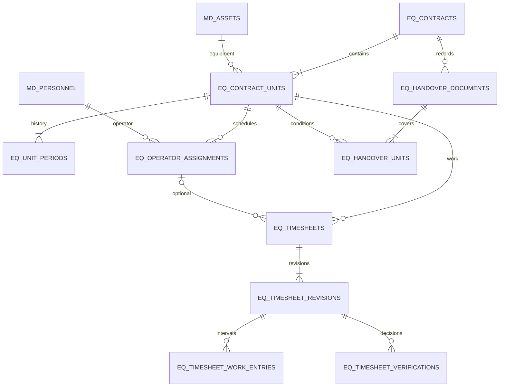

# Desain Equipment Operasional — Tahap 6

## Runtime M5 — Timesheet dan Verifikasi

Mandat M5 mengizinkan timesheet scoped/own dan verifikasi dengan schema existing, tanpa M6/M7/Finance. Root unit/assignment/work_date, interval WITA lintas malam dan break, HM terpisah, revisi berhistori, hash submission dan keputusan no-self-approval. Klarifikasi pengguna dan aturan terminal/histori CONFIRMED → CANCELLED setelah RETURN dicatat di DECISIONS.md dan BUSINESS_RULES.md; tidak mengubah lifecycle M4. Jalur runtime serta hasil aktual: PHASE6_M5_REPORT.md. Reset/penggantian HM khusus dan koreksi fakta BA tetap BLOCKED.

## Mandat M4 — BA Equipment, 24 Oktober 2026

M4 diizinkan oleh pengguna setelah M3. Bagian batas M1–M3 di bawah adalah riwayat. Implementasi: BA draft/edit/cancel, HANDOVER/RETURN subset/ALL atomik, nomor BA, snapshot/histori, bukti privat, detail/cetak, koreksi administratif terhubung tanpa lifecycle ulang. Hasil eksekusi dan batas: PHASE6_M4_REPORT.md. Tidak memulai M5–M7.

Klarifikasi pengguna M4: bukti opsional JPEG/PNG/PDF <=5 MB/file tanpa penghapusan aplikasi; operator hanya ACTIVE ketika intervalnya mencakup HANDOVER, jadwal berikutnya tetap CONFIRMED tanpa scheduler otomatis; RETURN menutup penugasan aktual dan membatalkan yang belum mulai dengan histori. NORMAL/EARLY dipilih petugas, EARLY wajib alasan/contract.terminate; aggregate terminal setelah seluruh detail/penugasan selesai, TERMINATED bila ada EARLY. Addendum administratif tidak mengubah tanggal/kondisi/HM/snapshot sumber. Koreksi fakta/reset HM menunggu SOP khusus (BLOCKED), C tidak diberi grant default. Recovery master nonaktif tetap khusus/beralasan/diaudit.

## Mandat M3 — 24 Oktober 2026

M1–M2 telah lulus dan pengguna mengizinkan **M3 Kontrak Sewa multi-unit/reservasi beserta antarmuka Kontrak Sewa**. Catatan batas M1–M2 di bawah adalah riwayat. Tidak mengizinkan M4–M7, Finance atau deployment.

Implementasi M3 memakai eq_* existing tanpa migration baru: DRAFT header/customer/proyek, detail unit dan periode, WITH/WITHOUT dan penugasan operator; konfirmasi header/detail, KS saat konfirmasi header, cancellation pra-ACTIVE, serta histori event/audit/request atomik. DRAFT tambahan setelah header confirm belum mengikat; konfirmasi detail menerapkan semua guard tanpa nomor KS baru. Edit detail DRAFT menambah versi periode, tidak menghapus versi sebelumnya.

Perpanjangan dua langkah: usulan eq_unit_periods EXTENSION belum efektif, lalu penerapan terotorisasi memeriksa konflik/versi/approval kembali dan memindah pointer current_period_id atomik. Penugasan pengganti memakai previous_assignment_id. Pengganti DRAFT membatalkan draf lama dengan histori; pengganti CONFIRMED tetap DRAFT sampai konfirmasi pengganti membatalkan jadwal lama dan mengikat jadwal baru atomik. Perubahan operator yang sudah ACTIVE menunggu alur BA/pengembalian; M3 tidak membuat lifecycle baru.

Tanggal sewa inklusif, operator [awal,akhir), shift lintas tengah malam sah. Unit DRAFT tidak mereservasi. Unit ACTIVE yang belum kembali menolak reservasi berikutnya walaupun tanggal rencana berbeda. Semua sumber dikunci melalui row master yang stabil sebelum pemeriksaan konflik current locking read, termasuk saat kalender reservasi awal kosong; semua detail batch rollback jika ada satu kegagalan.

Lintas cabang terikat unit/operator, kontrak dan versi periode. Request dari cabang kontrak, persetujuan pihak pemilik dan pengelola dari dua akun berbeda. Mandat M3 menegaskan **tidak boleh self-approval**: pemohon bukan salah satu approver. Role/akun global tidak melewati guard ini. Kedua approver tetap aktif/berizin/bercakupan ketika konfirmasi dijalankan. Pencabutan menyimpan histori/aktor/alasan dan tidak otomatis mengakhiri kontrak. **Semua C tetap tanpa grant default**. Penugasan permission approval harus eksplisit; fixture uji mendapat grant sementara hanya di DB disposable lalu dibersihkan.

Route nyata: GET/POST /equipment/contracts (equipment.contract.view + permission aksi) dan GET/POST /equipment/authorizations (equipment.cross_branch.approve). Portal approval hanya memproyeksikan sumber/periode/cabang/alasan yang relevan, tanpa customer atau full kontrak cabang lain. Own Operator tidak memperoleh full contract.view dari view_own. Satu menu Kontrak Sewa di registry existing, shortcut Admin Sewa; tidak membuat menu BA/Timesheet/Verifikasi atau halaman Equipment lain.

KS/{KODE_CABANG}/{TAHUN}/{000001} diterbitkan memakai waktu konfirmasi WITA/counter KS tersendiri, bukan periode rental. Cancel tidak menghapus nomor. Guard kode cabang kini mengenali eq_document_sequences selain exp_sequences dengan lock cabang yang sama. Generator DN/MF tidak diubah. Semua POST memakai CSRF router; permission/scope/master/state/version diperiksa server dalam transaksi. Token acak terikat actor/action/payload/branch, replay tidak mengulang nomor/event. Named lock per request key melindungi first-use token yang sama pada dua koneksi; transaksi/row lock menjaga konflik kalender dan sequence. Deadlock/constraint ditolak 409 dengan rollback penuh dan retry token yang sama.

Hasil aktual pengujian, file berubah, status grant development dan batas fitur dicatat pada PHASE6_M3_REPORT.md. Berhenti setelah M3; transisi ACTIVE/COMPLETED/TERMINATED operasional, BA, timesheet/verifikasi, halaman Equipment lainnya dan audit akhir belum diimplementasikan.

24 Oktober 2026, WITA. **Baseline desain disetujui; izin implementasi hanya M1–M2.** Baseline pengguna bersifat sementara untuk pengembangan V2, belum SOP resmi perusahaan. Mandat terbaru mengizinkan skema aditif setelah gate; route dan workflow Equipment belum diizinkan. Dokumen pendamping: [state machine](EQUIPMENT_STATE_MACHINE.md), [permission](EQUIPMENT_PERMISSION_MATRIX.md), [rencana implementasi](PHASE6_IMPLEMENTATION_PLAN.md).

## Dasar dan gerbang Tahap 5

Sumber: PHASE6_PROPOSAL.md, BUSINESS_RULES.md, DECISIONS.md, DATABASE_DESIGN.md, MASTER_DATA_DESIGN.md, UI_DESIGN_SYSTEM.md, TRUCKING_DESIGN.md, TRUCKING_STATE_MACHINE.md, PHASE5_REPORT.md, PHASE5_FINAL_AUDIT.md dan PHASE5_AUDIT_REPAIR_REPORT.md. Usulan satu unit per kontrak dalam proposal lama **digantikan mandat terbaru multi-unit**; catatan A01–A04 masih terbuka pada proposal lama sudah digantikan laporan perbaikan.

Gate M1 benar-benar dijalankan pada 24 Oktober 2026, selesai 15:33:17 WITA: 661 integrasi/HTTP dan 1.982 assertion browser lulus, termasuk 26 regresi A01–A04. Sesudah pemasangan M2, regresi penuh kembali lulus (15:46:03 WITA). A01–A04 tetap PASS; Q03/Q04/Q09 tidak berubah. Detail uji schema Equipment, preservation dan batas runtime di PHASE6_M1_M2_REPORT.md. Tidak mengklaim workflow Equipment sudah dibuat.

## Status keputusan

**B/G = baseline disetujui pengguna; U = rincian teknis desain.** Register terbaru di akhir dokumen menggantikan status G terbuka pada versi sebelumnya. Status pemasangan aktual M2 dan dictionary DDL dicatat dalam PHASE6_M1_M2_REPORT.md; layar/service masih rancangan. Register G01–G12 pada bagian akhir menjadi satu rujukan keputusan bagi keempat dokumen.

| ID | Baseline B yang harus dipertahankan |
|---|---|
| B01–B03 | Satu kontrak banyak unit; sewa dengan/tanpa operator; beberapa operator pada satu unit melalui penugasan tidak bertabrakan |
| B04 | Jam kerja dan HM dicatat terpisah; selisih HM bukan otomatis jam kerja atau dasar tarif |
| B05–B07 | BA seluruh kontrak/subset unit, kondisi/histori per unit; status sewa per unit; header tetap ACTIVE selama ada penugasan aktif belum selesai |
| B08–B10 | Periode sewa inklusif; unit direservasi saat CONFIRMED, bukan DRAFT; reservasi unit/jadwal operator tidak boleh bertabrakan |
| B11–B15 | Perpanjangan/penghentian berhistori; APPROVED tidak ditimpa; pembuat tidak menyetujui sendiri; operator tanpa akun dapat dicatat Admin Sewa berwenang; lintas cabang perlu otorisasi eksplisit |
| B16–B18 | KS/{KODE_CABANG}/{TAHUN}/{000001}, BA/{KODE_CABANG}/{TAHUN}/{000001}; terbit saat konfirmasi, nomor committed tidak dipakai ulang |
| B19 | Finance, invoice, pembayaran, Petty Cash, Inventory dan tarif otomatis di luar Tahap 6 |

Kontrak B: DRAFT → CONFIRMED → ACTIVE → COMPLETED; CANCELLED sebelum ACTIVE, TERMINATED untuk penghentian setelah ACTIVE. Timesheet B: DRAFT → SUBMITTED → APPROVED; RETURNED/REJECTED dan revisi berhistori mengikuti G07 yang telah disetujui pada state machine; tetap baseline sementara V2.

## Model domain dan hubungan

Kontrak adalah header customer/cabang/ketentuan. Detail kontrak mengacu **satu unit fisik** dengan periode/statusnya sendiri. Penugasan operator berada di bawah detail unit dan dapat berjumlah nol/banyak. Pengembalian satu unit tidak menyelesaikan unit lain. Status ketersediaan pada halaman unit dihitung dari reservasi/aktivitas aktual, bukan active pada master dan bukan satu flag global yang menghilangkan booking masa depan.

### Master yang digunakan ulang

branches; md_customers; md_assets **kind=equipment**; md_personnel **kind=operator**; users dan user_branches. md_equipment_tariffs hanya referensi jika ditampilkan, tidak dihitung. md_locations dapat menjadi lokasi proyek jika sesuai; proyek/alamat teks snapshot di kontrak diusulkan agar tidak membuat master proyek tanpa kebutuhan. Tidak membuat ulang unit, tenant/customer atau akun operator. account_id opsional bukan izin login/grant otomatis.

Kelayakan aksi baru memeriksa master terkini di dalam transaksi; snapshot identitas/ketentuan dokumen yang sudah dikonfirmasi tetap disimpan. Pembacaan histori tidak ditolak hanya karena master kemudian nonaktif. Pengembalian/penutupan operasional pada sumber yang sudah berjalan perlu pengecualian master aktif yang eksplisit agar aset nonaktif tidak menjebak kontrak; kebijakan ini G10, bukan bypass semua permission/cabang.

## Rancangan database header-detail

Model 15 tabel konseptual berikut diperjelas menjadi **16 tabel aktual M2**, dengan eq_meter_corrections pada bagian penajaman di bawah. DDL 005 adalah rujukan kolom/nama constraint terpasang; tabel konseptual menjelaskan tujuan domain. ID mengikuti jenis unsigned sumber V2, InnoDB/utf8mb4, FK bernama RESTRICT, timestamp WITA sesuai fondasi, version untuk optimistic locking. ID cabang peristiwa disimpan eksplisit; histori tidak dihapus/cascade.

| Tabel | Field/relasi inti | Constraint/index yang direncanakan |
|---|---|---|
| eq_contracts | id, internal_ref, official_number NULL sebelum confirm, branch_id, customer_id, status, snapshot, project/address snapshot, confirmed/activated/closed timestamps, closure_kind, created_by, version | Unique internal_ref/official_number; FK customer+branch komposit; CHECK status header; index branch/status/id dan customer/id |
| eq_contract_units | id, contract_id, contract_branch_id, asset_id, asset_owner_branch_id, line_no, operator_mode WITH/WITHOUT, status, current_period_id, actual_start/end, version, snapshot | Unique contract/line_no dan generated contract/active_asset untuk detail DRAFT/CONFIRMED/ACTIVE; detail terminal tetap historis (G12); unique id/contract untuk FK detail; FK asset+owner branch; index asset/status dan contract/status |
| eq_unit_periods | id, contract_unit_id, revision_no, starts_on, ends_on inclusive, previous_period_id, change_kind INITIAL/EXTENSION/EARLY_END, effective_at, reason, actor_id | Unique detail/revision; CHECK starts_on≤ends_on; FK periode sebelumnya milik detail sama; index detail/id. Revisi efektif append-only; pointer detail menunjuk versi yang berlaku |
| eq_operator_assignments | id, contract_unit_id, operator_id, operator_owner_branch_id, starts_at, ends_at_exclusive, status, previous_assignment_id, effective_account_id snapshot opsional, reason/version | FK operator+owner branch dan detail; CHECK start<end; index operator/status/start/end dan detail/status/start. Perubahan jadwal confirmed menggunakan record pengganti dan event, bukan menghapus penugasan lama |
| eq_branch_authorizations | id, contract_unit_id, operator_assignment_id opsional, resource/contract/owner branch, period_revision, requester, owner/contract approver, decision, valid interval, reason, timestamps/version | FK detail/penugasan; index detail/decision dan branch/decision. Persetujuan terikat sumber/periode, bukan grant global. G05: dua approver berbeda akun, grant C tidak disemai |
| eq_handover_documents | id, contract_id, type HANDOVER/RETURN, scope_mode ALL/SELECTED, status, internal_ref, official_number, occurrence_at, confirmed_at, correction_of_id NULL, created_by, version | Unique refs; FK kontrak dan correction_of pada kontrak sama; CHECK type/state; index contract/type/status/time dan branch melalui kontrak |
| eq_handover_units | id, handover_id, contract_id, contract_unit_id, condition_note, HM reading opsional, snapshot, occurrence_at | Unique BA/detail; FK komposit BA+contract dan detail+contract menjamin satu kontrak; kondisi per unit wajib pada U. HM BA bukan pengganti timesheet; presisi/opsional G03/G08 |
| eq_timesheets | id, contract_unit_id, operator_assignment_id NULL bila WITHOUT, work_date, root_created_by, effective_approved_revision_id NULL, pending_revision_id NULL, version | FK detail/assignment konsisten; U unique detail/work_date/assignment-scope (NULL dinormalisasi untuk WITHOUT); index detail/date dan operator/date. Granularitas satu seri per unit/penugasan operator/hari disahkan G02 |
| eq_timesheet_revisions | id, timesheet_id, revision_no, previous_revision_id, base_approved_revision_id, status, created_by, submitted_by/at, work_note, hm_start/end NULL, snapshot, content_hash, version | Unique root/revision; FK previous/base pada root sama; CHECK HM berpasangan/nonnegatif/end≥start (U G03); state sesuai tabel transisi; index status/submitted_at/id |
| eq_timesheet_work_entries | id, revision_id, line_no, starts_at, ends_at_exclusive, break_minutes, activity_note | Unique revision/line; CHECK start<end, break≥0; index revision/start/end. Total menit integer dihitung dari interval, tidak float; HM terpisah di revisi |
| eq_timesheet_verifications | id, revision_id, reviewer_id, decision APPROVED/RETURNED/REJECTED, note, decided_at, request_key | Satu keputusan per submission/revision pada model revisi immutable (unique revision); FK reviewer/revision; index reviewer/time. Author diikat FK komposit; CHECK lokal reviewer berbeda dari root/revision author, ditambah guard service kelak |
| eq_events | id, contract_id, contract_unit_id/period_id/operator_assignment_id/handover_id/timesheet_revision_id opsional, event_type, previous/next state, actor_id, branch_id, request_key, detail JSON, occurred_at, recorded_at | FK setiap sumber, konsistensi kontrak/detail di service/komposit; CHECK JSON; index contract/id, detail/id, handover/id, revision/id, request_key. Event append-only |
| eq_requests | request_key, actor_id, action, resource type/id, scope_branch, payload_hash, committed_result JSON, created_at | Token unique, FK aktor/cabang, CHECK JSON; replay terikat identitas/aksi/payload/scope; tidak menyimpan secret/CSRF/file temporer |
| eq_document_sequences | document_type KS/BA, branch_id, year, last_value | PK type/branch/year; FK branch; CHECK type/counter≤999999; counter dan nomor resmi commit atomik dengan dokumen/event/audit |
| eq_evidence | id, handover_unit_id ATAU timesheet_revision_id ATAU meter_correction_id, actor_id, storage_key, filename, MIME, size, SHA256, recorded_at | CHECK tepat satu target; FK; unique storage_key dan target/hash; index target/id. Bukti privat disahkan G08; format/batas/retensi/tanda tangan masih perlu keputusan sebelum M4 |

U: satu root timesheet hanya mengacu satu detail unit dan nol/satu penugasan operator. Beberapa operator pada unit yang sama mempunyai root terpisah; beberapa interval kerja pada revisi yang sama tetap milik penugasan tersebut. G02 menetapkan root per unit/penugasan operator/tanggal; WITHOUT memakai assignment NULL yang dinormalisasi unique key. HM dari beberapa root tidak dijumlahkan menjadi jam kerja unit.

Pointer current_period/pending/effective_revision adalah proyeksi keadaan terkini, bukan perubahan isi dokumen historis. Karena ada relasi siklik header-detail/pointer, rencana migration membuat tabel dulu dengan pointer nullable lalu menambah FK setelah target tersedia. Foreign key pointer komposit harus memastikan sumber milik root/detail yang sama. Tidak mengandalkan penonaktifan foreign_key_checks.

Kolom snapshot bukan sumber otorisasi. Relasi operator/personnel/account harus cocok dengan konteks kini dan identitas penugasan; perubahan account_id tidak boleh diam-diam memberikan akses histori kepada akun lain. Rebinding eksplisit dan pencabutan akses memerlukan desain G11. Operator tanpa akun tetap mempunyai ID personel; created_by adalah Admin Sewa yang benar-benar mencatat, bukan ID operator fiktif.

## Periode, reservasi dan histori

- **B:** tanggal sewa [mulai, akhir] inklusif. 1–10 dan 10–15 bertabrakan; 1–10 dan 11–15 tidak bertabrakan untuk reservasi tanggal. U untuk query teknis: [mulai 00:00 WITA, hari setelah akhir 00:00) agar kesetaraan batas jelas.
- **U:** jadwal operator memakai interval waktu setengah terbuka [start,end); shift 08:00–12:00 dan 12:00–16:00 tidak tumpang tindih. Datetime lengkap lintas tengah malam dan batas setengah terbuka telah disahkan G02/G04. Tidak mengubah inklusivitas periode sewa.
- DRAFT tidak memblokir jadwal. Konfirmasi seluruh kontrak memeriksa semua unit dan operator yang diikutkan secara atomik; satu konflik menggagalkan semuanya. Penugasan operator baru pada kontrak confirmed/active harus langsung melewati validasi reservasi, bukan menyisipkan draf yang dianggap aktif.
- Unit tidak boleh overlap antarkontrak atau detail yang berbeda. Operator tidak boleh overlap antarunit/kontrak. Kebijakan konservatif U juga menolak dua operator serentak pada unit yang sama sesuai B03; beberapa operator boleh berurutan. Tanpa operator tidak membuat personel atau jadwal rekaan.
- Tidak menandai COMPLETED karena tanggal akhir lewat. Pekerjaan ACTIVE belum dikembalikan tetap ACTIVE. Booking berbasis rencana dan keterlambatan aktual harus dibedakan: aktivasi unit berikutnya ditolak jika unit masih aktif di kontrak lain. G04 mengesahkan overdue tetap digunakan; detail pemanfaatan sisa hari setelah actual return memerlukan keputusan sebelum workflow terkait.
- Perpanjangan menambah eq_unit_periods dan event, mengunci ulang sumber, mengecek konflik dan memperluas otorisasi lintas cabang bila perlu. Nomor KS tetap; histori periode lama tidak berubah. Header periode tampilan merupakan rentang detail, bukan alasan mengubah semua detail sekaligus.
- Penghentian meminta penutupan per unit dan penugasan operator; selama ada unit ACTIVE yang belum selesai header tetap ACTIVE. U: niat penghentian dicatat event/closure_kind, header baru TERMINATED setelah seluruh pekerjaan aktif ditutup. Mengubah header menjadi TERMINATED sambil unit masih ACTIVE dilarang. G06 mengesahkan terminal per unit dengan pengembalian aktual dan header tanpa detail terbuka.

## Penomoran KS dan BA

**B:** nomor saat konfirmasi, unik, tidak dipakai ulang; internal_ref tetap. **U:** tahun waktu konfirmasi WITA, counter per type/cabang/tahun dan enam digit, cabang KS adalah cabang kontrak; cabang BA juga cabang kontrak meskipun sumber unit lintas cabang. G09 telah mengesahkan rincian tahun/cabang ini.

Service Equipment kelak memakai counter KS/BA tersendiri. Jangan memasukkan KS/BA ke exp_sequences atau mengubah aturan DN/MF. Untuk mencegah kode cabang dipakai ulang sesudah nomor Equipment pertama, rencana aditif harus memperluas **pemeriksaan lock kode cabang** agar mendeteksi nomor Equipment juga; perilaku T5 tetap identik bagi DN/MF. Allocator dan perubahan kode cabang mengunci row branches yang sama. Nomor pada CANCELLED/BA dikoreksi tetap tersimpan; rollback sebelum commit tidak mempublikasikan nomor. Tidak menerbitkan INV di Tahap 6.

## Transaksi, idempotensi, konkurensi dan audit

**Rincian teknis transaksi M3–M5 yang wajib diuji kelak:** satu unit kerja = validasi izin/master/scope terkini → validasi state/version → perubahan sumber → event → audit → request-result → commit. Semua POST CSRF, prepared PDO, output escaped. Auth_version, role/grant dan effective membership diperiksa kembali; all_branches tidak mengganti permission atau persetujuan lintas cabang.

Strategi urutan lock global: actor/grant/membership dan cabang terkait secara konsisten → kontrak terurut → **master unit md_assets terurut** → master operator md_personnel terurut → detail/periode/penugasan terurut → BA/timesheet/pointer → sequence. Perintah yang belum tahu ID induk boleh discovery read scoped lalu wajib re-read/lock dan memvalidasi ulang hubungan. Semua writer jadwal, termasuk extension/termination/cancel, harus mengikuti urutan yang sama. Allocator tidak boleh mengambil lock cabang baru setelah lock sumber; cabang penomoran sudah dikunci di awal.

Lock master sumber stabil menyelesaikan kasus **tidak ada row reservasi**: dua transaksi konfirmasi unit yang sama tetap bersaing pada row asset yang sama. Setelah menunggu, overlap dibaca current locking read, bukan snapshot REPEATABLE READ lama. CHECK/unique biasa tidak bisa menegakkan interval non-overlap; jangan mengklaim unique(asset_id) menyelesaikan kalender multi-periode. Query overlap: existing.start < requested.end_exclusive AND existing.end_exclusive > requested.start, hanya versi/periode yang berlaku dan status pengikat sesuai state machine. Riwayat yang digantikan tidak dihitung ganda.

Perubahan master oleh modul T4 juga memakai lock sumber; transaksi Equipment tetap mengunci/membaca ulang master agar perubahan status/peran tidak lolos setelah form terbuka. Deadlock/serialization failure harus rollback penuh dan memberi konflik/retry aman dengan token sama, bukan sukses palsu. Batch banyak unit disortir dan seluruhnya commit/rollback.

Idempotensi: token acak 64 hex, hash payload kanonis mencakup ID/versi detail, interval, tipe BA, unit yang tercakup dan hash bukti. Token sama+payload/aktor/aksi sama mengembalikan hasil commit; token berbeda tidak melewati state/version/constraint. Replay wajib memeriksa akses kini, tidak mengulang state mutation atau membuat nomor/event. Scope dokumen yang baru berubah harus direvalidasi sebelum hasil replay dibaca.

Event menyimpan sebelum/sesudah, periode/revisi/sumber, alasan, aktor, cabang, occurred_at aktual dan recorded_at server. Audit dan event atomik; tanpa password/hash autentikasi/CSRF. GET detail tidak mencatat event operasional baru. Bukti diberi nama random privat, hash dan endpoint download berizin; crash bisa menyisakan orphan, sehingga rencana cleanup hanya menghapus orphan tervalidasi, tidak histori/bukti yang direferensikan. Format/retensi Equipment perlu keputusan sebelum M4; tidak mengubah upload Klaim T5.

## Desain lima halaman desktop/mobile

Usulan path dalam tabel adalah **kontrak antarmuka untuk review**, belum route terdaftar. Lima item Equipment pada registry yang sama baru diaktifkan setelah endpoint nyata dan permission disetujui. Tidak menambahkan menu aksi atau redesign sidebar/bottom nav. Warna/logo/token HLS dan komponen T2 dipakai ulang.

| Halaman U | Desktop | Mobile | Aksi/data penting |
|---|---|---|---|
| Unit Alat Berat — /equipment/units | Tabel unit, pemilik cabang, kalender/periode rencana, kontrak/aktivitas saat ini | Kartu ringkas atau tabel scroll lokal, filter dapat dilipat | Read dari md_assets + penugasan, indikator aktif master terpisah dari sedang disewa/booking. Detail jadwal yang tidak diizinkan tidak dibocorkan sebagai customer/nama operator |
| Kontrak Sewa — /equipment/contracts | Header customer/cabang/proyek; tabel detail banyak unit, operator, periode/status; tab histori | Header ringkas; kartu tiap unit, aksi sesuai state; formulir multi-unit bertahap dengan ringkasan sebelum konfirmasi | Tambah/edit draf, confirm, lihat nomor KS, penugasan operator, extension, pengembalian/penutupan/cancel/terminate sesuai izin. Tampilkan unit yang masih aktif sebagai alasan header belum ditutup |
| Berita Acara — /equipment/handovers | Daftar jenis/status/KS/BA/tanggal; detail cakupan dan kondisi tiap unit | Pilih ALL/SELECTED, kartu kondisi per unit, ringkasan jumlah; bukti jika disepakati | Saat ALL dipilih, daftar ID unit eligible diekspansi dan dibekukan ketika confirm. Penambahan unit kemudian tidak mengubah BA lama. Mixed state/noneligible tidak dibuang diam-diam; pilih subset atau perbaiki input |
| Timesheet — /equipment/timesheets | Filter tanggal/kontrak/unit/operator/status/revisi; form interval kerja dan panel HM terpisah | Form satu kolom, interval berulang, total menit baca-saja dan HM opsional terpisah | Operator hanya milik penugasan sendiri; Admin Sewa dapat mencatat operator tanpa akun/without operator. Tampilkan versi approved efektif dan revisi pending terpisah; tidak mengedit APPROVED |
| Verifikasi Timesheet — /equipment/verification | Antrian SUBMITTED; detail perbandingan revisi, jadwal, jam/HM, histori dan keputusan | Detail sebelum tombol approve/return/reject, dialog catatan, versi yang diperiksa jelas | Pemilik/pembuat tidak memperoleh tombol approve dan POST tetap ditolak. Konfirmasi keputusan terikat revision_id/version/content_hash; tidak ada nominal invoice |

Semua daftar punya search/filter cabang/status/tanggal yang relevan, pagination database setelah scope, empty/error/loading/conflict state. Form mempertahankan input aman; perubahan master setelah form terbuka mendapat penolakan yang jelas. Identifier KS/BA/nomor internal dan alasan panjang membungkus, tabel scroll lokal, tombol akhir bebas bottom nav. Pengguna dapat melihat alasan, aktor dan waktu event historis aktual. Layout 320/375/402/768/1366 wajib diuji kelak; belum ada klaim visual PASS hanya dari dokumen ini.

## Register G01–G12 — DISETUJUI

Mandat implementasi 24 Oktober 2026 menetapkan seluruh keputusan berikut sebagai baseline sementara V2, belum SOP resmi perusahaan. Register ini mengatasi semua label pertanyaan G/U historis pada uraian di atas.

### G01 — Berita Acara dan lifecycle unit

1. BA serah terima wajib untuk mengaktifkan unit.
2. Konfirmasi BA HANDOVER mengubah unit terkait dari CONFIRMED menjadi ACTIVE.
3. Konfirmasi BA RETURN menyelesaikan unit terkait sesuai jenis penyelesaian yang sah.
4. BA dapat mencakup seluruh unit atau sebagian unit dalam satu kontrak.
5. Setiap unit mempertahankan status dan histori masing-masing.
6. Konfirmasi BA multi-unit harus atomik: seluruh unit berhasil atau seluruh transaksi ditolak.
7. BA tidak boleh memicu perubahan status dua kali.

### G02 — Timesheet

1. Timesheet dicatat per unit, penugasan operator, dan tanggal kerja.
2. Mendukung beberapa interval kerja dalam satu timesheet.
3. Mendukung waktu istirahat.
4. Mendukung pekerjaan yang melewati tengah malam dengan datetime lengkap.
5. Interval kerja menggunakan batas awal inklusif dan akhir eksklusif.
6. Jam kerja dan HM disimpan terpisah.
7. Operator tanpa akun dicatat Admin Sewa yang berwenang.
8. Penyewaan WITHOUT operator tidak boleh membuat operator fiktif.

### G03 — Hour Meter

1. HM bersifat opsional.
2. Jika diisi, HM awal dan akhir wajib berpasangan.
3. Nilai HM normal tidak boleh menurun.
4. Reset atau penggantian meter memerlukan prosedur koreksi khusus, alasan, bukti, dan otorisasi.
5. Selisih HM tidak otomatis menjadi jam kerja atau nominal tagihan.

### G04 — Periode dan keterlambatan

1. Periode sewa berdasarkan tanggal inklusif.
2. Jadwal operator menggunakan interval datetime setengah terbuka.
3. Reservasi mulai berlaku saat kontrak CONFIRMED.
4. Unit tidak otomatis COMPLETED ketika tanggal kontrak berakhir.
5. Unit yang belum dikembalikan secara sah tetap dianggap digunakan.
6. Keterlambatan harus terlihat pada sistem.
7. Unit tidak boleh diaktifkan pada kontrak lain selama masih aktif pada kontrak sebelumnya.
8. Perubahan periode wajib berhistori dan diperiksa terhadap konflik jadwal.

### G05 — Persetujuan lintas cabang

1. Penggunaan unit/operator lintas cabang memerlukan persetujuan eksplisit.
2. Persetujuan dilakukan oleh pihak berwenang dari cabang pemilik sumber dan cabang pengelola kontrak.
3. Kedua persetujuan harus dilakukan oleh akun berbeda.
4. Administrator, Owner, atau akun dengan all_branches tidak otomatis melewati persetujuan tersebut.
5. Persetujuan terikat unit/operator, kontrak, dan periode.
6. Perpanjangan di luar periode yang disetujui memerlukan persetujuan tambahan.
7. Pencabutan persetujuan tidak boleh menghapus histori atau otomatis mengakhiri penyewaan yang sudah aktif.

### G06 — Perubahan detail kontrak

1. Satu kontrak dapat berisi banyak unit.
2. Penambahan unit setelah konfirmasi diperbolehkan melalui proses tambahan yang tercatat dan diotorisasi.
3. Unit tambahan wajib melewati validasi reservasi, konflik, dan lintas cabang.
4. Pembatalan detail hanya diperbolehkan sebelum unit ACTIVE.
5. Unit ACTIVE yang dihentikan lebih awal harus melalui prosedur pengembalian sah.
6. Kontrak tidak boleh COMPLETED atau TERMINATED selama masih ada unit/penugasan aktif atau detail yang belum diselesaikan.
7. Semua perubahan mempertahankan histori.

### G07 — Verifikasi dan revisi timesheet

1. Reviewer harus berbeda dari pembuat root dan pembuat revisi yang diperiksa.
2. Larangan self-approval berlaku untuk semua role, termasuk Administrator.
3. Timesheet SUBMITTED tidak dapat diedit langsung.
4. RETURNED dan REJECTED membutuhkan alasan.
5. Perbaikan dilakukan melalui revisi baru.
6. APPROVED lama tidak boleh ditimpa.
7. Revisi APPROVED yang baru menggantikan versi efektif secara atomik.
8. Revisi pending atau ditolak tidak menghilangkan versi approved sebelumnya.
9. Hanya satu revisi pending yang diperbolehkan pada satu root.

### G08 — Berita Acara dan bukti

1. BA confirmed bersifat immutable.
2. Koreksi administratif menggunakan dokumen koreksi yang terhubung dengan BA sebelumnya.
3. Koreksi tidak boleh mengulangi aktivasi atau pengembalian unit.
4. BA yang telah mengubah lifecycle unit tidak boleh dibatalkan langsung.
5. Kesalahan fakta operasional harus ditangani melalui prosedur koreksi khusus dengan histori dan otorisasi.
6. Bukti disimpan secara privat dengan validasi file dan pemeriksaan akses.
7. Bukti dan histori dokumen yang telah dikonfirmasi tidak boleh dihapus sembarangan.

### G09 — Penomoran dokumen

Format resmi:

KS/{KODE_CABANG}/{TAHUN}/{000001}

BA/{KODE_CABANG}/{TAHUN}/{000001}

Ketentuan:

1. Nomor diterbitkan ketika dokumen dikonfirmasi.
2. Counter terpisah berdasarkan jenis dokumen, cabang kontrak, dan tahun konfirmasi WITA.
3. BA menggunakan cabang kontrak meskipun unit berasal dari cabang lain.
4. Nomor committed tidak boleh digunakan ulang.
5. Pembatalan atau koreksi tidak menghapus nomor.
6. Kode cabang dikunci setelah nomor resmi Equipment pertama diterbitkan.
7. Jangan mengubah generator nomor DN/MF Tahap 5.

### G10 — Master nonaktif

1. Master nonaktif tidak dapat digunakan untuk penugasan baru.
2. Penugasan yang sudah berjalan tetap dapat dibaca sesuai permission.
3. Penutupan/pengembalian operasional yang sah harus tetap dimungkinkan melalui prosedur recovery terkendali.
4. Recovery tidak boleh melewati pemeriksaan permission, cabang, histori, atau self-approval.
5. Seluruh pengecualian harus diaudit.

### G11 — Akun operator

1. Identitas operator menggunakan ID personel, bukan nama bebas.
2. Operator dapat memiliki akun atau tidak.
3. Operator tanpa akun tidak dibuatkan akun dummy.
4. Penggantian atau penautan ulang akun harus eksplisit dan tercatat.
5. Akun baru tidak otomatis memperoleh akses ke seluruh histori operator.
6. Operator berakun hanya dapat mengakses penugasannya sendiri sesuai scope yang sah.

### G12 — Pengulangan unit dan koreksi terminal

1. Satu unit fisik hanya memiliki satu detail aktif dalam kontrak yang sama.
2. Perpanjangan menggunakan histori periode, bukan membuat duplikasi detail unit.
3. Timesheet yang sudah approved dapat dikoreksi melalui revisi berhistori.
4. Koreksi setelah kontrak terminal memerlukan permission khusus, alasan, dan audit.
5. Koreksi historis tidak boleh mengaktifkan kembali kontrak atau reservasi.
6. Jangan mengubah kontrak terminal menjadi ACTIVE hanya karena revisi timesheet.

## Penajaman database M2

DDL 005_equipment_operations.sql adalah dictionary teknis aktual: 16 tabel eq_*, menggunakan master existing tanpa penggandaan. Tambahan ke 15 tabel konseptual adalah **eq_meter_corrections** untuk G03: tipe RESET/REPLACEMENT, reading sebelumnya/pengganti, alasan, requester, authorizer/waktu, status dan pointer bukti wajib saat AUTHORIZED. eq_evidence mempunyai tepat satu target BA-unit/revisi timesheet/koreksi meter; FK pointer bukti memastikan bukti milik koreksi yang benar.

G12 memakai unique(contract_id,active_asset_id) generated hanya pada DRAFT/CONFIRMED/ACTIVE; bukan unique seumur hidup. G02 root unique menormalisasi NULL assignment WITHOUT. G07 unique pending_root_id membatasi satu DRAFT/SUBMITTED; pointer revisi/current period memakai FK komposit milik root/detail yang benar. Verification menyimpan ID author dengan FK komposit terhadap root/revisi dan CHECK reviewer berbeda dari keduanya. G05 CHECK dua approver berbeda dan kelengkapan waktu approval. BA-unit mempunyai unique(unit,lifecycle_effect) untuk efek awal HANDOVER/RETURN; koreksi administratif memakai NULL effect.

HM DECIMAL(12,3), jam datetime WITA lengkap termasuk lintas tengah malam, break integer menit; durasi dan HM tetap terpisah. CHECK HM normal berpasangan/nonnegatif/nonmenurun. Reset disimpan pada prosedur khusus, bukan melonggarkan CHECK reading normal. G09 counter KS/BA terpisah dari exp_sequences, tanpa allocator runtime M2.

Semua FK RESTRICT. Histori tidak dihapus atau dibackfill rekaan. DDL mendukung aturan, tetapi tidak menggantikan validasi transaksi: kind master, active/scope, overlap kalender, transisi, immutable confirmed/approved, pointer APPROVED saja, sinkronisasi aggregate, audit atomik dan penerbitan nomor/lock kode cabang Equipment baru dilaksanakan M3–M5. Metadata eq_requests bukan endpoint; token collision unique belum membuktikan replay bisnis. Bukti privat belum memiliki upload/download Equipment.

## Batas mandat dan keputusan tambahan

M1 gate T1–5 harus lulus sebelum M2. M2 hanya skema/permission aditif dan pengujian migration; tidak ada controller, service bisnis, repository, view, route/menu Equipment atau M3–M7. Keputusan pengguna: jangan seed grant C; definisi permission saja. Seluruh C tetap deny termasuk Administrator; lihat matriks. Batas file/retensi/tanda tangan dan otoritas koreksi khusus serta kebijakan pemanfaatan sisa hari actual return perlu review sebelum implementasi terkait. Tidak mengubah aturan Trucking/Finance. Hasil pemasangan dan uji aktual: PHASE6_M1_M2_REPORT.md.
