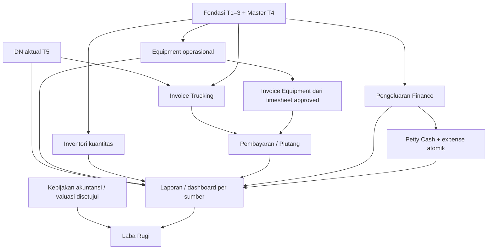

# Usulan ruang lingkup Tahap 6 — HLS Transport System V2

Tanggal: 24 Oktober 2026, WITA. **Status: analisis dan usulan untuk persetujuan; bukan mandat implementasi atau keputusan bisnis final.**

Rekomendasi utama: **Equipment operasional — unit, kontrak sewa, berita acara, timesheet dan verifikasi**, setelah keputusan SOP Equipment dan penanganan temuan audit Tahap 5 disepakati. Finance menjadi pekerjaan berikutnya yang terpisah; tidak memasukkan seluruh backlog ke Tahap 6. Jika penagihan Trucking lebih mendesak bagi bisnis, Finance Trucking dapat dipilih sebagai alternatif melalui persetujuan tersendiri.

Analisis ini hanya membaca dokumen dalam proyek V2. Tidak menjalankan aplikasi, pengujian, koneksi database, migration atau installer; tidak mengakses proyek/database lama maupun hosting. Satu keluaran baru adalah dokumen ini. Angka/status pengujian yang disebutkan merupakan hasil terdokumentasi sebelumnya, bukan pengujian baru pada sesi perencanaan.

## Dasar, sumber dan cara membaca status

Dokumen yang ditelaah: [README](README.md), [IMPLEMENTATION_PLAN](IMPLEMENTATION_PLAN.md), [BUSINESS_RULES](BUSINESS_RULES.md), [DECISIONS](DECISIONS.md), [DATABASE_DESIGN](DATABASE_DESIGN.md), [PROGRESS](PROGRESS.md), [CHANGELOG](CHANGELOG.md), [MASTER_DATA_DESIGN](MASTER_DATA_DESIGN.md), [TRUCKING_DESIGN](TRUCKING_DESIGN.md), [TRUCKING_STATE_MACHINE](TRUCKING_STATE_MACHINE.md), [UI_DESIGN_SYSTEM](UI_DESIGN_SYSTEM.md), [NAVIGATION_BACKLOG](NAVIGATION_BACKLOG.md), [DASHBOARD_WIDGETS](DASHBOARD_WIDGETS.md), [CPANEL_PREPARATION](CPANEL_PREPARATION.md), [PROJECT_AUDIT](PROJECT_AUDIT.md), PHASE1_REPORT.md sampai PHASE5_REPORT.md, serta [PHASE5_FINAL_AUDIT](PHASE5_FINAL_AUDIT.md): 21 dokumen yang tersedia sebelum proposal ini.

Label berikut berlaku di seluruh proposal:

- **TERTULIS:** kebutuhan, batas atau keputusan yang sudah tercatat; penyebutan dalam backlog tidak otomatis memberi izin implementasi.
- **USULAN:** pilihan ruang lingkup, arsitektur, tabel, permission atau urutan yang direkomendasikan; belum disetujui.
- **PERLU KEPUTUSAN:** hal yang harus diputuskan pengguna/Manager sebelum perilaku terkait dibuat. Tidak memakai konfigurasi demo lama sebagai SOP perusahaan.

IMPLEMENTATION_PLAN.md saat ini hanya merinci Tahap 1–5; tidak menetapkan bahwa Tahap 6 harus Equipment, Finance, Inventory atau Petty Cash. Istilah “Tahap 6” dalam dasar historis aturan Petty Cash bukan penetapan nomor tahap V2 berikutnya. Inventaris tabel proyek lama di DATABASE_DESIGN.md juga bukan daftar tabel yang sudah terpasang pada V2 dan tidak boleh disalin sebagai migration baru.

### Catatan kesiapan Tahap 5

PHASE5_REPORT.md menyatakan enam modul selesai pada baseline sementara dan mencatat 635 pemeriksaan integrasi/HTTP serta 1.952 assertion browser lulus. Namun PHASE5_FINAL_AUDIT.md yang lebih baru mencatat empat probe tambahan gagal: konfirmasi DN dengan lokasi asal nonaktif, validasi ulang peran pengirim, keberangkatan dari lokasi muat nonaktif, serta alasan pembatalan yang belum tampil di detail Manifest. Tidak ada dokumen perbaikan yang menutup temuan tersebut dalam kumpulan dokumen yang dibaca.

Pernyataan selesai pada laporan implementasi dipertahankan sebagai konteks pengguna; **tidak ditafsirkan sebagai bukti empat temuan audit sudah diperbaiki**. Analisis Tahap 6 dapat berjalan. Usulan gerbang sebelum implementasi berikutnya: pengguna menetapkan penanganan temuan dan baseline penerimaan; A02 memerlukan penegasan kelayakan snapshot versus peran master terkini. Perbaikan tetap pekerjaan terpisah yang memerlukan mandat, bukan otomatis dilaksanakan melalui proposal ini. Tidak mengubah Q03/Q04/Q09 atau state machine Tahap 5.

## A. Inventarisasi modul yang belum dibangun

### A.1. Backlog bisnis yang tertulis

NAVIGATION_BACKLOG.md bagian terkini mencatat **23 item belum tersedia**, bukan 23 sistem terpisah. Master unit, customer, tarif dan barang sudah ada; halaman operasional yang memakai master tersebut belum berarti tersedia.

| Kelompok | Seluruh item tertulis yang belum dibangun | Batas status |
|---|---|---|
| Equipment — 5 item | Unit Alat Berat operasional; Kontrak Sewa; Berita Acara; Timesheet; Verifikasi Timesheet | Master md_assets kind=equipment dan md_personnel kind=operator sudah ada; status sewa/penugasan tidak boleh diturunkan dari active master |
| Keuangan — 6 item | Invoice Trucking; Invoice Equipment; Pembayaran; Piutang; Pengeluaran; Petty Cash | Format INV disetujui, tetapi transaksi/issuance INV belum dibuat |
| Gudang & Inventori — 6 item | Barang Masuk; Barang Keluar; Stok Barang; Transfer Stok; Pemakaian Barang; Stock Opname | md_items adalah katalog global; belum saldo per gudang/cabang atau ledger |
| Laporan — 6 item | Trucking; Equipment; Keuangan; Gudang; Petty Cash; Laba Rugi | Tidak sama dengan daftar transaksi, timeline atau KPI administrasi yang sudah tersedia; Laba Rugi belum memiliki dasar akuntansi |

Kelengkapan lintas modul yang juga tertulis: adapter dashboard bisnis per role/Owner, grafik dan monitoring cabang, akses Customer atas pengiriman sendiri, notifikasi dengan sumber event/penerima/status baca, serta PWA dari konteks blueprint/audit. Kelengkapannya belum dibangun. Tracking internal sudah ada dan **tidak dimasukkan ulang** sebagai modul baru. Pelacakan publik berbeda dari portal Customer terautentikasi dan belum mempunyai mandat.

Editor grant dinamis, profil/ganti password mandiri, pemulihan password/email, remember-me dan retensi otomatis audit tercatat sebagai batas/gap fondasi, bukan cakupan bisnis Tahap 6 yang otomatis wajib. Penjadwalan armada, koreksi/retur DN, penerimaan sebagian, maintenance, pembelian/utang supplier dan integrasi bank tidak boleh diasumsikan termasuk backlog transaksi yang telah disetujui.

### A.2. Analisis setiap kandidat

Seluruh nama tabel berikut adalah **USULAN konseptual**, bukan SQL, jumlah tabel final atau instruksi migration. Gunakan ulang master dan ID yang sudah ada; jangan membuat ulang rent_units/rent_tenants atau inv_items hanya karena nama tersebut terdapat dalam inventaris historis. Seluruh matriks grant baru di bawah juga **USULAN**, bukan hak akses yang sudah diberikan.

#### K1. Equipment operasional

| Aspek | Analisis |
|---|---|
| Tujuan dan fitur TERTULIS | Mengelola siklus penyewaan: daftar/detail unit operasional, kontrak customer/unit/operator, berita acara terkait kontrak, pencatatan timesheet dan verifikasi dengan histori |
| Dependensi Tahap 1–5 | T1 autentikasi/RBAC/cabang/audit; T2 komponen dan navigasi; T3 fokus Admin Sewa/Operator; T4 customer/unit/operator/tarif. Tidak bergantung pada transaksi Trucking T5 untuk menghitung sewa; T5 memberi pola transaksi dan regresi, bukan SOP rental |
| Master tersedia | branches, md_customers, md_assets kind=equipment, md_personnel kind=operator, users/account_id opsional, md_equipment_tariffs; md_locations hanya jika konteks proyek/lokasi disepakati |
| Tabel/relasi USULAN | eq_contracts → cabang/customer; eq_assignments → kontrak/unit/operator; eq_handovers → kontrak/penugasan; eq_timesheets → penugasan; eq_timesheet_events dan eq_contract_events; eq_verified_sources → timesheet/revisi terverifikasi. Bukti privat bila disetujui. Perlu/tidaknya master proyek baru ditentukan dari kebutuhan kontrak, bukan disalin otomatis |
| Hak akses/cabang USULAN | Admin Sewa kelola kontrak/penugasan/berita acara dan verifikasi sesuai grant; Operator hanya penugasan/timesheet miliknya melalui account_id yang sah; Owner baca terbatasi cabang; Administrator sesuai grant. Reviewer harus memenuhi pemisahan pembuat/pemeriksa yang disetujui. Tidak memberi grant lewat nama role runtime |
| PERLU KEPUTUSAN | Q06/Q08: jumlah unit/operator, operator wajib/opsional, rentang kontrak, konflik jadwal dan titik reservasi, jenis berita acara, revisi/perpanjangan, pengajuan/pengembalian/penolakan timesheet, reviewer, unit waktu, nomor kontrak/berita acara. Q07 untuk jam/shift/bulan dan batas nominal referensi |
| Risiko | Satu unit teralokasi ganda, operator tanpa akun mengakses milik orang lain, timesheet tumpang tindih, koreksi menimpa bukti terverifikasi, perubahan master mengubah histori. Batas demo satu unit/operator, tanggal inklusif, BAP sekali dan tanpa lintas hari belum merupakan SOP final |

#### K2. Invoice Trucking dan fondasi invoice bersama

| Aspek | Analisis |
|---|---|
| Tujuan dan fitur TERTULIS | Menagih DN: draft, pengajuan/pengembalian koreksi, penerbitan, void/histori; satu invoice aktif per DN pada draft/submitted/returned/issued; nomor INV hanya ISSUED; nominal manual, bukan tarif/pajak otomatis (B03–B06) |
| Dependensi Tahap 1–5 | T1–4 keamanan/master customer; T5 exp_dns dan identitas/nomor/scope DN. Keberangkatan, receipt atau klaim tidak otomatis membuat invoice. Tahap DN yang boleh menjadi sumber tagihan belum diputuskan |
| Master tersedia | branches, md_customers; md_trucking_tariffs sebagai referensi opsional, bukan nominal wajib; users untuk pembuat/penerbit |
| Tabel/relasi USULAN | fin_invoices dengan divisi dan sumber; fin_invoice_sources → exp_dns; fin_invoice_events; counter resmi dan request ledger Finance. Desain unique active DN mencakup seluruh state aktif, bukan hanya issued. Customer/sumber disnapshot |
| Hak akses/cabang USULAN | Admin Pengirim menyiapkan draft; Finance/Administrator berizin menerbitkan; Owner baca dengan permission/cakupan. Bukan kewenangan otomatis dari all_branches. Hak edit/submission oleh pembuat atau delegasi harus diputuskan |
| PERLU KEPUTUSAN | Q01 penerbitan langsung atau wajib draft/submitted; Q02 kepemilikan/delegasi/cabang pencatat; syarat kelayakan DN, tanggal jatuh tempo/void dan ketentuan dokumen; Q05 grant per aksi. Format nomor tidak dibuka ulang |
| Risiko | Dua jalur penerbitan berbeda otorisasi, nomor ganda, satu DN ditagih dua kali, nominal berubah pascaterbit. exp_sequences sekarang dibatasi DN/MF; generator INV memerlukan desain aditif, bukan sekadar memanggil service yang ada |

**USULAN teknis lintas divisi:** satu namespace INV per cabang/tahun untuk Trucking dan Equipment sesuai format yang sudah disetujui; jangan membuat counter per divisi yang menghasilkan nomor identik. Counter/keunikan perlu berlaku pada kedua jenis invoice dan tetap mengunci kode cabang setelah nomor resmi pertama, termasuk cabang yang pertama kali menerbitkan INV. Implementasi penomoran DN/MF yang sudah ada harus dipertahankan. Rancangan detail akan direview sebelum migration Finance.

#### K3. Invoice Equipment

| Aspek | Analisis |
|---|---|
| Tujuan dan fitur TERTULIS | Menagih kontrak menggunakan **timesheet disetujui saja**; invoice dapat dibuat selama kontrak berjalan; penambahan sumber tidak otomatis menaikkan nominal (B07–B08) |
| Dependensi Tahap 1–5 | T1–4 fondasi/master; membutuhkan K1 timesheet/revisi terverifikasi serta fondasi invoice K2. Tidak bergantung pada receipt DN atau Manifest |
| Master tersedia | Customer bersama md_customers, unit/operator/tarif Equipment, cabang; bukan master tenant duplikat |
| Tabel/relasi USULAN | fin_invoices dan fin_invoice_sources bersama → eq_contracts dan eq_verified_sources; snapshot sumber serta relasi pembatalan/penggantian. Tidak membuat satu invoice tunggal seumur hidup kontrak; aturan periode dan pemakaian ulang sumber perlu diputuskan |
| Hak akses/cabang USULAN | Admin Sewa menyiapkan sumber/draft bila disetujui; Finance menerbitkan; Owner baca. Operator tidak otomatis melihat nominal atau invoice |
| PERLU KEPUTUSAN | Siklus penagihan, pemilihan sumber, revisi timesheet yang sudah ditagih, sumber pada invoice void, tanggung jawab draft; Q01/Q02/Q05 diperluas secara eksplisit ke Equipment |
| Risiko | Timesheet belum approved ikut tagihan, sumber sama ditagih dua kali, invoice mengubah timesheet, koreksi historis mengubah nominal yang sudah terbit |

#### K4. Pembayaran dan Piutang

| Aspek | Analisis |
|---|---|
| Tujuan dan fitur TERTULIS | Catat pembayaran invoice issued, sisa/piutang dan histori reversal; tidak melebihi sisa efektif; koreksi melalui reversal, bukan hapus (B05/B09) |
| Dependensi Tahap 1–5 | Fondasi T1–4 dan K2/K3 invoice issued. Tidak memerlukan Inventory/Petty Cash. Tidak menyamakan pembayaran dengan pendapatan akuntansi |
| Master tersedia | Customer/cabang/users. Rekening/metode bayar belum didokumentasikan sebagai master terpasang; perlu keputusan jika dibutuhkan |
| Tabel/relasi USULAN | fin_payments → fin_invoices; fin_payment_reversals unik per pembayaran; fin_events/requests. Piutang terutama query dari invoice dikurangi pembayaran efektif, bukan tabel saldo terpisah tanpa rekonsiliasi |
| Hak akses/cabang USULAN | Finance berizin payment/reversal; Owner baca; cabang invoice/penerimaan pembayaran harus diputuskan. Petugas operasional tidak memperoleh hak bayar melalui akses DN |
| PERLU KEPUTUSAN | Pembayaran sebagian/DP/termin, tanggal bayar, metode/referensi, reversal oleh siapa, lintas cabang, tanggal jatuh tempo dan aging. Saldo terkini terfilter berbeda dari saldo historis akhir periode |
| Risiko | Overpayment bersamaan, reversal ganda, salah cabang, piutang tidak sesuai histori, pelaporan kas dianggap laba |

#### K5. Pengeluaran

| Aspek | Analisis |
|---|---|
| Tujuan dan fitur TERTULIS | Catat pengeluaran cabang dan bukti; menjadi sumber laporan pengeluaran dan integrasi realisasi Petty Cash |
| Dependensi Tahap 1–5 | T1–4 fondasi/supplier; dapat dirancang tanpa invoice atau Equipment. Integrasi asal Petty Cash baru tersedia setelah K7 |
| Master tersedia | branches, md_suppliers, users; kategori pengeluaran finansial belum ditetapkan. md_categories adalah kategori barang, bukan otomatis kategori biaya |
| Tabel/relasi USULAN | fin_expenses, fin_expense_evidence/events, relasi sumber dan unique source Petty Cash; kategori biaya baru hanya jika disetujui |
| Hak akses/cabang USULAN | Finance buat/koreksi sesuai izin; reviewer dan Owner baca mengikuti kebijakan; bukti privat dan scope cabang transaksi |
| PERLU KEPUTUSAN | Kategori, penanggung jawab/persetujuan, tanggal, bukti wajib/menyusul, koreksi/reversal, sumber pembayaran; tidak menganggap semua pengeluaran otomatis expense akuntansi pada periode sama |
| Risiko | Duplikasi biaya manual/Petty Cash, bukti bocor, penghapusan histori, pencampuran kas dan beban |

#### K6. Gudang dan Inventori

| Aspek | Analisis |
|---|---|
| Tujuan dan fitur TERTULIS | Barang masuk/keluar, saldo stok, transfer, pemakaian dan opname; katalog global tetap terpisah dari saldo tiap gudang/cabang |
| Dependensi Tahap 1–5 | T1–4 fondasi/katalog/supplier/unit. Tidak membutuhkan Trucking DN atau Finance untuk kuantitas dasar. Pemakaian dapat mengacu unit/operasi hanya jika hubungan bisnis disepakati |
| Master tersedia | md_items, md_units, md_categories, md_suppliers, md_assets dan branches; belum master gudang sebagai lokasi penyimpanan |
| Tabel/relasi USULAN | inv_warehouses → branches; inv_documents/lines → item/satuan/gudang; inv_stock unik gudang/item; inv_ledger; inv_transfers dengan leg keluar/terima; inv_counts/count_lines; relasi pemakaian ke unit opsional sesuai keputusan |
| Hak akses/cabang USULAN | Gudang melakukan mutasi cabang aktif; penerimaan transfer di tujuan dengan grant tujuan; Owner baca; approval opname/penyesuaian oleh pihak yang ditetapkan. Katalog global tidak memberikan baca semua saldo |
| PERLU KEPUTUSAN | Q10: satu/banyak item, stok awal dan otorisasi, nonnegatif, satuan/konversi, jumlah desimal, transfer parsial/penolakan/koreksi, pemakaian, cutoff/opname dan reviewer. Batas demo lama tidak otomatis disahkan |
| Risiko | Saldo negatif karena race, transfer diterima ganda, opname menimpa saldo yang berubah, barang kiriman DN disamakan dengan stok suku cadang. Valuasi/HPP bukan hasil saldo kuantitas |

#### K7. Petty Cash

| Aspek | Analisis |
|---|---|
| Tujuan dan fitur TERTULIS | Pengajuan, persetujuan, pencairan, realisasi, pengembalian dan pertanggungjawaban. Pencairan menambah kas cabang; realisasi mengurangi; pengembalian mengurangi kas tanpa expense (B10–B12) |
| Dependensi Tahap 1–5 | T1–4 keamanan/cabang dan **K5 Pengeluaran lebih dahulu**, karena satu realisasi wajib menghasilkan/menaut tepat satu expense atomik; bukan modul kas mandiri tanpa Finance |
| Master tersedia | branches, users, supplier bila relevan. Akun kas/saldo awal/reviewer belum tersedia sebagai master operasional |
| Tabel/relasi USULAN | pc_accounts, pc_requests, pc_entries, pc_evidence/events; unique expense_id/source ke fin_expenses; versi/lock saldo serta korelasi realisasi-pengembalian |
| Hak akses/cabang USULAN | Pemohon/pengelola kas cabang dan Finance berizin, reviewer terpisah dari pembuat. Role pemohon dan delegasi belum diputuskan; jangan otomatis memberi semua Admin cabang hak pencairan |
| PERLU KEPUTUSAN | Q10/Q05: limit, siapa menyetujui, saldo awal, bukti, pengajuan bersamaan, realisasi melebihi pencairan, koreksi dan periode pertanggungjawaban |
| Risiko | Pembuat menyetujui sendiri, kas negatif, biaya dua kali, transaksi kas commit tetapi expense gagal; tutup hanya jika realisasi + pengembalian efektif = pencairan |

#### K8. Laporan operasional dan adapter dashboard bisnis

| Aspek | Analisis |
|---|---|
| Tujuan dan fitur TERTULIS | Enam laporan backlog dan dashboard per role/Owner dengan filter cabang/periode, rincian sumber dan tren sah; sumber bisnis tidak diganti angka dummy |
| Dependensi Tahap 1–5 | Laporan/dashboard Trucking dapat memakai exp_dns, Manifest, event, receipt dan klaim T5; Equipment memerlukan K1; Keuangan K2–K5; Gudang K6; Petty Cash K7. Laba Rugi mempunyai ketergantungan tambahan K9 |
| Master tersedia | Cabang/customer/unit/barang sesuai sumber; users/roles untuk scope, bukan sebagai pengganti data bisnis |
| Tabel/relasi USULAN | Awalnya query/view-model dari sumber, tanpa tabel salinan KPI. Indeks dan kolom cabang audit eksplisit bila diperlukan merupakan desain aditif terpisah. Metadata scope audit tidak ditebak dari aktor/JSON |
| Hak akses/cabang USULAN | Permission laporan/dataset/ekspor spesifik; Owner baca hanya dalam grant dan cabangnya; Operator hanya pekerjaan sendiri. Filter serta download wajib backend-scoped |
| PERLU KEPUTUSAN | Tanggal dokumen atau event untuk tiap metrik, definisi selesai/dalam perjalanan, histori vs kondisi kini, SLA/mendekati akhir/stok minimum, granularitas dan ekspor. Cetak/PDF/CSV adalah opsi implementasi, bukan otomatis semuanya wajib |
| Risiko | Join menggandakan DN/payment, klaim approved dianggap kompensasi, saldo kini diklaim saldo periode lalu, rincian/ekspor bocor. Tidak mengaktifkan semua widget hanya karena tabel sudah ada |

#### K9. Laba Rugi dan akuntansi

| Aspek | Analisis |
|---|---|
| Tujuan dan fitur TERTULIS | Laba Rugi ada sebagai target navigasi; B14 menegaskan pendapatan akuntansi, HPP, pajak dan depresiasi belum dihitung |
| Dependensi Tahap 1–5 | Fondasi/cabang dan data Finance; membutuhkan kebijakan akuntansi serta valuasi aset/persediaan yang belum ada. Bukan sekadar agregasi kas masuk dikurangi kas keluar |
| Master tersedia | Customer/supplier/unit/barang hanya referensi; belum bagan akun, saldo pembukaan, periode buku atau metode valuasi |
| Tabel/relasi USULAN | Jika disetujui kelak: bagan akun, periode, jurnal/entri, pemetaan sumber dan kebijakan pengakuan/valuasi. Belum memilih model jurnal atau membuat tabel sekarang |
| Hak akses/cabang USULAN | Finance/Owner baca sesuai permission; posting/closing/koreksi memerlukan otorisasi terpisah yang diputuskan |
| PERLU KEPUTUSAN | Q07: kas/akrual, pengakuan pendapatan/beban, HPP, pajak, depresiasi, closing, konsolidasi/interbranch; perlu persetujuan pihak keuangan/Manager |
| Risiko | Laporan finansial menyesatkan dan hitung ganda. **Ditunda; belum layak jadi Tahap 6** |

#### K10. Akses Customer dan notifikasi

| Aspek | Analisis |
|---|---|
| Tujuan dan fitur TERTULIS | Dashboard Customer membutuhkan pengiriman sendiri; notifikasi membutuhkan event/penerima/status baca (Q11). Ini dua kemampuan terpisah, bukan perluasan tracking internal otomatis |
| Dependensi Tahap 1–5 | Customer: T1 login dan T4 customer + T5 DN; notifikasi: event dari setiap modul yang dipilih. Nomor DN yang diketahui bukan bukti kepemilikan |
| Master tersedia | users role Customer dan md_customers, tetapi mapping identitas kepemilikan transaksi Customer belum diputuskan; audit/event operasional ada, bukan inbox siap pakai |
| Tabel/relasi USULAN | Customer: relasi akun-customer yang tervalidasi dan dibatasi cabang/entitas. Notifikasi: notifications/recipients/read_state; outbox jika pengiriman asinkron/kanal eksternal dipilih |
| Hak akses/cabang USULAN | Customer hanya DN miliknya, bukan seluruh DN cabang; pengguna internal membaca inbox sendiri. Kanal email/WhatsApp memerlukan mandat, identitas penerima dan kebijakan tersendiri |
| PERLU KEPUTUSAN | Q05/Q11: onboarding, pembuktian identitas, cakupan satu/banyak customer, informasi sensitif yang terlihat, event, penerima, kanal, retensi, unsubscribe dan deduplikasi |
| Risiko | Kebocoran data antarcustomer, notifikasi salah penerima, pesan sebelum transaksi commit. Tracking publik tetap di luar mandat |

PWA/installable shell, profil/password mandiri dan editor permission dinamis adalah kandidat pendukung terpisah, **bukan kandidat utama bisnis Tahap 6**. PWA tertulis pada konteks blueprint/audit; usulan kelak hanya aset statis, tanpa cache respons autentikasi/transaksi. Tidak perlu tabel untuk shell; push memerlukan keputusan/notifikasi tambahan. Profil/password dapat memakai users dan audit yang ada dengan autentikasi ulang serta pencabutan sesi. Editor grant memerlukan matriks Q05, pembatasan eskalasi dan audit; role_permissions tersedia tetapi bukan izin memberi grant apa saja. Tujuan, kebijakan retensi/keamanan dan persetujuan masing-masing harus ditetapkan sebelum dijadwalkan. Backup/restore, dukungan DB/provider dan paket hosting termasuk kesiapan rilis yang tertulis di CPANEL_PREPARATION.md; bukan deployment yang diotorisasi.

## B. Analisis dependensi

Master T4 dan fondasi T1–3 merupakan dependensi bersama. **Equipment dan Inventory tidak secara teknis menunggu invoice**, sedangkan Invoice Equipment wajib menunggu sumber timesheet terverifikasi. Invoice Trucking dapat berjalan sebelum Equipment bila prioritas bisnis berubah. Pengeluaran tidak harus menunggu invoice, tetapi Petty Cash harus memakai integrasi expense yang sah.

Panah adalah kebutuhan sumber, bukan nomor tahap yang ditetapkan. Invoice Trucking/Equipment disarankan berbagi fondasi dokumen/penomoran/keamanan Finance; itu tidak berarti keduanya harus dirilis sekaligus. Laporan ditambahkan bersama sumber yang sudah lulus, bukan menunggu semua modul selesai. Pengiriman invoice, pengakuan pendapatan, perjalanan, penerimaan dan klaim tetap proses terpisah.

## C. Rekomendasi prioritas Tahap 6

| Urutan USULAN | Pekerjaan | Alasan dan gerbang |
|---|---|---|
| P0 — sebelum implementasi baru | Penetapan tindak lanjut audit T5 dan keputusan SOP berikutnya | Dua sumber status T5 berbeda; jangan mewariskan validasi yang belum konsisten. Tidak ada perbaikan otomatis dalam mandat analisis |
| P1 — kandidat Tahap 6 | **Equipment operasional K1** | Master sudah siap; melengkapi divisi utama kedua dan menyediakan timesheet sah untuk Finance Equipment. Wajib keputusan Q06/Q08/Q05 dan batas Q07; tidak membuat tagihan |
| P2 — setelah sumber/keputusan siap | Finance bersama, Invoice Trucking K2 lalu Invoice Equipment K3 | DN sudah ada; Equipment menyusul setelah verifikasi. Q01/Q02 menentukan satu jalur penerbitan dan kepemilikan draft |
| P3 | Pembayaran/Piutang K4 dan Pengeluaran K5 sebagai paket terpisah | Pembayaran perlu issued; Pengeluaran dapat lebih awal bila prioritas kas memerlukannya |
| P4 — jalur independen | Inventory K6: saldo/ledger, lalu transfer/pemakaian/opname | Dapat didahulukan setelah Q10 jika operasi gudang lebih mendesak; tidak dipaksakan menunggu Finance |
| P5 | Petty Cash K7 | Setelah K5 supaya realisasi dan expense tidak terpisah atau terhitung ganda |
| Bertahap | Laporan/dashboard K8 | Hanya metrik dari sumber yang lulus dan definisinya disetujui; SLA/aging/ambang bukan asumsi |
| Setelah keputusan khusus | Customer/notifikasi, PWA dan kelengkapan akun | Kebutuhan identitas, kanal, scope/retensi dan ancaman berbeda; jangan disisipkan demi melengkapi menu |
| Terakhir, setelah kebijakan keuangan | Laba Rugi K9 | Bergantung pengakuan akuntansi/valuasi; bukan ringkasan kas |

**Alternatif untuk disetujui:** Finance Trucking menjadi Tahap 6 jika tujuan utama adalah penagihan dan Q01/Q02 bisa segera dikunci, sedangkan Q06 belum siap. Batas alternatif: invoice Trucking dan fondasi Finance saja, bukan langsung invoice Equipment, bank, pajak otomatis, Petty Cash atau akuntansi. Tidak berpindah ke alternatif secara otomatis ketika SOP Equipment belum dijawab. Nomor tahap setelah Tahap 6 belum ditetapkan.

## D. Ruang lingkup yang diusulkan

### D.1. Sasaran paket utama: Equipment operasional saja

1. Halaman Unit Alat Berat operasional membaca identitas master yang sama dan menampilkan keterlibatan kontrak/penugasan aktual; tidak menggandakan CRUD master atau menganggap master aktif berarti tersedia disewa.
2. Kontrak sewa: daftar/search/filter/pagination, buat/draf/detail/perubahan yang diizinkan; customer, cabang, unit, penugasan operator, lokasi/proyek, periode dan snapshot sesuai keputusan. State machine dan tabel transisi harus disetujui sebelum implementasi.
3. Berita acara: dokumen aktual terkait kontrak/penugasan, jenis serah-terima/pengembalian/jumlahnya ditetapkan lebih dahulu; petugas, tanggal, kondisi dan bukti jika diwajibkan. Tidak memakai BAP sekali dari demo sebagai keputusan default.
4. Timesheet: pekerjaan/durasi/satuan sesuai SOP, keterkaitan penugasan dan operator, validasi tanggal/periode, submit dan koreksi sesuai state yang disetujui; histori tidak ditimpa.
5. Verifikasi timesheet: reviewer berizin, keputusan/catatan/waktu, pemisahan pembuat/pemeriksa dan snapshot/revisi terverifikasi untuk sumber tagihan masa depan. **Tidak membuat invoice atau nominal otomatis.**
6. Integrasi izin/cabang/penugasan sendiri, audit atomik, idempotensi, version/locking dan bukti privat bila digunakan. Controller/service/repository tetap terpisah, migration aditif hanya saat implementasi diotorisasi; tidak reset development.
7. Aktifkan hanya lima submenu Equipment yang benar-benar berfungsi. Posisi header/sidebar/drawer/bottom navigation tetap. Ringkasan sederhana Equipment boleh diusulkan dari sumber aktual setelah definisi disetujui; SLA/tren/Finance/dashboard lintas modul bukan bagian inti paket.
8. Pengujian, bukti desktop/mobile, regresi T1–5 dan laporan akhir terpisah. Tetapkan kriteria penerimaan sebelum mulai.

### D.2. Batas desain yang diusulkan untuk mengendalikan kompleksitas

**Untuk dipilih, bukan diberlakukan:** mulai dari satu unit per kontrak dan penugasan operator eksplisit dengan histori. Jika Manager memerlukan multi-unit/multi-operator sejak awal, gunakan struktur header-detail/penugasan yang sesuai sebelum migration; jangan membuat skema satu unit lalu mengklaim multi-unit sudah didukung. Operator tanpa account_id tidak boleh dipetakan ke login berdasarkan nama; tentukan siapa mencatat timesheet bagi operator tersebut.

Tarif jam/shift/bulan tetap referensi manual nullable. Definisi jam kerja, shift, lintas tengah malam dan pembulatan durasi harus diputuskan untuk pencatatan; kalkulasi invoice/overtime/prorata/pajak tetap ditunda. Format nomor kontrak/berita acara belum disetujui: putuskan sebelum membuat nomor resmi, tanpa meminjam format DN/MF/INV.

### D.3. Kriteria penerimaan USULAN

Lima halaman harus membentuk alur transaksi aktual dari master → kontrak/penugasan → berita acara sesuai SOP → timesheet → verifikasi → sumber approved yang immutable/berversi. Uji negatif dan konkurensi wajib membuktikan isolasi cabang/pekerjaan sendiri, pencegahan alokasi ganda menurut SOP, larangan transisi ilegal dan rollback tanpa data parsial. Tidak ada test kritis FAIL/BLOCKED/NOT TESTED dalam lingkup yang disepakati sebelum klaim selesai; fitur di luar scope dilaporkan terpisah. Tidak ada klaim PASS berdasarkan route/screenshot saja.

## E. Fitur yang sengaja ditunda

| Ditunda dari paket utama | Alasan |
|---|---|
| Seluruh transaksi Finance, termasuk INV dan pembayaran | Paket operasional menghasilkan sumber, bukan langsung penagihan; B03–B09 dipertahankan |
| Gudang/Inventori dan Petty Cash | Modul terpisah dengan Q10 dan integrasi saldo/expense sendiri |
| RA sebagai dokumen atau pengganti kontrak | Q06 belum mendefinisikan RA; kontrak tetap istilah yang dipertahankan |
| Tarif harian, overtime, prorata, diskon/pajak, gaji, bahan bakar, mobilisasi dan margin | Aturan/formula belum disetujui; tidak dihitung dari referensi tarif |
| Maintenance, pembelian/utang supplier, integrasi bank/gateway, GPS | Belum mandat modul pada V2; bukan syarat melengkapi menu yang ada |
| Multi-unit/multi-operator, shift lintas hari atau BAP kompleks | Bukan otomatis ditolak; memerlukan keputusan awal. Jika dipilih, scope/skema/usaha perlu direvisi sebelum implementasi |
| Penerimaan parsial/retur/koreksi DN dan finansial klaim | Tidak mengubah baseline operasional T5 atau membuat refund/kompensasi otomatis |
| Dashboard seluruh divisi, enam laporan penuh dan Laba Rugi | Sumber/definisi belum lengkap; hanya integrasi kecil sumber Equipment jika disetujui |
| Customer publik/internal, notifikasi kanal eksternal, PWA/offline transaksi | Memerlukan mandat identitas/keamanan/retensi tersendiri; transaksi offline tidak diasumsikan |
| Migrasi data lama, staging/hosting/cPanel dan deployment | Di luar mandat; hanya rencana kesiapan rilis yang sudah tertulis tetap dicatat |

## F. Keputusan bisnis yang masih diperlukan

### F.1. Tetap terkunci — tidak dimintakan keputusan ulang

Q03 trip-based/lintasan eksplisit/keanggotaan aktif tunggal/histori pergantian kendaraan; Manifest selesai bukan receipt. Q04 format DN/MF/INV, saat penerbitan, counter jenis/cabang/tahun, nomor committed tidak dipakai ulang dan kode cabang terkunci pascanomor pertama. Q09 status klaim operasional, bukti boleh menyusul, tanpa efek Finance. Penerimaan utuh dan CANCELLED Manifest sebelum berangkat dengan alasan/histori tetap berlaku.

B03–B09 Finance dan B10–B12 Petty Cash yang tercatat sebagai aturan dipertahankan. Persetujuan berikutnya mengisi celah workflow/otorisasi, bukan membatalkan satu invoice aktif per DN, sumber timesheet approved, nominal manual, pembayaran issued, reversal dan expense atomik.

### F.2. Harus dijawab sebelum Equipment operasional dibuat

| ID proposal | Hubungan dokumen | Keputusan yang dibutuhkan | Penanggung persetujuan yang diusulkan |
|---|---|---|---|
| E01 | Q06 | Satu/banyak unit, satu/banyak operator, operator wajib/opsional, perekam bila operator tanpa akun | Pengguna + Manager operasional |
| E02 | Q06/Q08 | Tanggal inklusif/eksklusif, kontrak/penugasan status apa yang mereservasi unit, konflik unit/operator, perpanjangan, penghentian/pembatalan | Manager operasional |
| E03 | Q06 | Arti dan jenis Berita Acara, kapan wajib, siapa menandatangani/mencatat, bukti wajib/menyusul, revisi dan jumlah dokumen | Manager operasional |
| E04 | Q06/Q07 | Field timesheet, jam aktual/durasi/hm meter, satuan/shift, lintas tengah malam, batas/rentang dan presisi; tidak menganggap selisih meter otomatis jam tagihan | Manager operasional |
| E05 | Q05/Q06 | State kontrak/timesheet, submit/return/reject/approve/cancel; reviewer, pemisahan pembuat-pemeriksa, koreksi setelah approved/ditagih | Pengguna + Manager |
| E06 | Q04 khusus dokumen baru | Format dan titik terbit nomor kontrak/berita acara, namespace/counter/kode cabang, kebijakan tanggal mundur | Pengguna + Manager |
| E07 | Q05/Q08 | Cabang pemilik unit vs cabang kontrak/proyek, penugasan lintas cabang dan akses operator/Owner/Finance | Pengguna + Manager |
| E08 | PHASE5_FINAL_AUDIT | Tindak lanjut A01–A04 dan penegasan peran master terkini vs snapshot untuk A02 | Pengguna; Manager bila mengubah kebijakan kelayakan referensi |

Nama Manager di tabel adalah pemberi persetujuan bisnis, **bukan role aplikasi baru yang otomatis akan dibuat**. Reviewer pada aplikasi dipetakan ke akun/permission yang disetujui.

### F.3. Keputusan untuk kandidat setelahnya

Q01/Q02: jalur penerbitan invoice, pembuat/delegasi dan scope; Q05: matriks per aksi baca/buat/ubah/submit/approve/issue/void/reverse/download/ekspor serta retensi. Q07: perhitungan finansial dan akuntansi tetap terbuka. Q09 hanya bagian finansial klaim/rekonsiliasi yang masih terbuka, bukan alur operasional yang sudah disetujui. Q10: stok/transfer/opname/limit kas dan persetujuan. Q11: notifikasi. Identitas Customer, tanggal laporan/SLA/aging dan audit per cabang juga membutuhkan keputusan sebelum fitur terkait dibuat.

## G. Risiko dan strategi pengujian

Bagian ini adalah **rencana uji**, tidak berisi PASS/FAIL baru. Hasil historis T5 tetap rujukan baseline dengan pengecualian audit; tidak dijadikan kelulusan modul Equipment yang belum ada.

| Risiko | Pengujian yang diusulkan saat implementasi diotorisasi |
|---|---|
| Perbedaan status T5 dalam dokumen | Putuskan penanganan temuan; reproduksi dan regresi A01–A04 setelah mandat terpisah. Jangan menutup temuan hanya dengan mengubah teks laporan |
| State machine rental tidak sesuai SOP | Matriks transisi positif/negatif per role; kontrak ditutup/dibatalkan tidak menerima timesheet baru; aturan revisi verified sesuai keputusan |
| Unit/operator dipakai dua penugasan bersamaan | Dua koneksi/proses dilepas dengan barrier pada interval sama dan batas tanggal; lock sumber konsisten; satu keputusan sah tanpa data parsial menurut SOP reservasi |
| Kebocoran cabang/pekerjaan Operator | Uji ID/URL/POST/download/ekspor dimanipulasi, membership/grant dicabut, cabang/akun/master nonaktif setelah form terbuka; Operator A tidak membaca timesheet Operator B |
| Timesheet ganda/approval ganda/replay | Token terikat aktor/aksi/payload, versi usang, submit berulang, dua reviewer, rollback audit dan korelasi hasil; source approved tidak digandakan |
| Referensi master berubah | Edit/nonaktif master setelah draf/konfirmasi, status dan penugasan terkini diperiksa pada titik yang disetujui; snapshot historis tetap, tanpa mengubah histori T5 |
| Lampiran tidak aman atau file/DB berbeda | Bila bukti masuk scope: MIME/ekstensi/ukuran/isi, akses privat dan hash, replay, rollback audit/file, pemulihan kegagalan; pelajaran NOT TESTED T5 tidak dianggap sudah terbukti |
| Perhitungan waktu/nominal keliru | Batas hari WITA, rentang/tanggal invalid, jam/shift sesuai SOP, presisi dan NULL vs nol; nominal/tarif tidak otomatis menjadi invoice |
| Migration aditif merusak dokumen lama | Fresh install dan upgrade pada DB disposable V2 berisi data; FK/CHECK/unique/index; pelestarian ID/nomor/event/receipt/klaim/file T1–5; tanpa reset development |
| UI hanya tampak lengkap | Jalankan alur nyata lima viewport 320×640, 375×812, 402×874, 768×1024, 1366×768; form/filter/dialog/riwayat/keyboard/overflow dan tombol bebas bottom nav |
| Regresi lintas modul | Suite integrasi/HTTP, permission/cabang, session/CSRF/rate limit, browser T1–5, PHP lint dan integritas DB. Catat jumlah assertion nyata dan jangan menghitung ulang subset sebagai total tambahan |
| Klaim kompatibilitas terlalu luas | MariaDB/Chromium lokal dibedakan dari MySQL 8, Safari/perangkat fisik/TLS/cPanel. Pengujian platform tambahan dijadwalkan hanya bila lingkungannya tersedia dan diotorisasi |

Untuk Finance/Inventory/Petty Cash berikutnya, tambahkan uji nomor INV lintas divisi dan tahun/counter habis, satu sumber invoice aktif, overpayment/reversal, saldo stok/opname/transfer, dan pasangan realisasi-expense dalam satu commit. Laporan harus direkonsiliasi dengan sumber dan scope yang sama. Estimasi waktu/jumlah test belum diberikan: keputusan SOP dan bentuk kontrak belum terkunci sehingga angka pasti akan menyesatkan.

## H. Pertanyaan yang membutuhkan persetujuan pengguna

1. **Pilihan tahap:** apakah Tahap 6 dipilih sebagai Equipment operasional saja (rekomendasi), atau Finance Trucking lebih mendesak? Tidak memilih otomatis berdasarkan urutan menu.
2. **Gerbang audit:** apakah A01–A04 akan ditangani lewat mandat perbaikan T5 terpisah sebelum implementasi tahap baru? Untuk A02, apakah kelayakan pihak pada konfirmasi mengikuti master terkini atau snapshot saat draf dibuat?
3. **Bentuk kontrak:** apakah satu unit per kontrak dan penugasan operator eksplisit cukup untuk awal, atau multi-unit/multi-operator wajib sejak awal? Apakah operator boleh tanpa akun dan siapa yang mencatat timesheet-nya?
4. **Periode/reservasi:** kapan unit/operator dianggap terikat, bagaimana konflik interval ditolak, serta bagaimana perpanjangan, pembatalan dan lintas cabang ditangani?
5. **Berita acara:** dokumen apa yang wajib pada serah-terima/pengembalian, siapa berwenang, apakah bukti wajib dan bagaimana revisinya?
6. **Timesheet/verifikasi:** field/satuan/jam/shift apa yang dipakai, boleh lintas tengah malam atau tidak, siapa submit/reviewer, bagaimana return/reject/koreksi approved dan pemisahan pembuat-pemeriksa?
7. **Dokumen dan akses:** apa format/titik terbit nomor kontrak/berita acara, dan matriks izin Admin Sewa/Operator/Owner/Finance/Administrator untuk cabang serta penugasan sendiri?
8. **Batas hasil:** apakah paket dibatasi lima modul Equipment tanpa transaksi Finance, gudang, kas, RA, maintenance atau rumus tarif otomatis; dan apakah ringkasan Equipment berbasis sumber aktual termasuk atau ditunda?

Pertanyaan 1–2 menentukan arah/gerbang; E01–E07 menentukan spesifikasi sebelum kode. Jika memilih alternatif Finance Trucking, diperlukan jawaban Q01/Q02/kelayakan DN dan matriks Finance terlebih dahulu, bukan menjalankan daftar Equipment di atas secara otomatis. Persetujuan arah proposal tidak dianggap persetujuan semua pilihan SOP yang belum dijawab. Setelah keputusan, susun mandat implementasi dengan state machine, scope dan kriteria penerimaan yang konkret.

**Status akhir: proposal selesai untuk ditinjau. Tahap 6 belum diimplementasikan. Tidak ada kode, database, migration atau dokumen perencanaan existing yang diubah. Berhenti dan menunggu persetujuan pengguna.**
